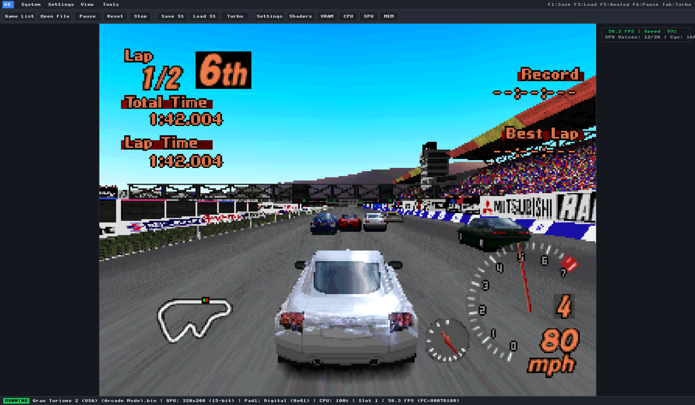
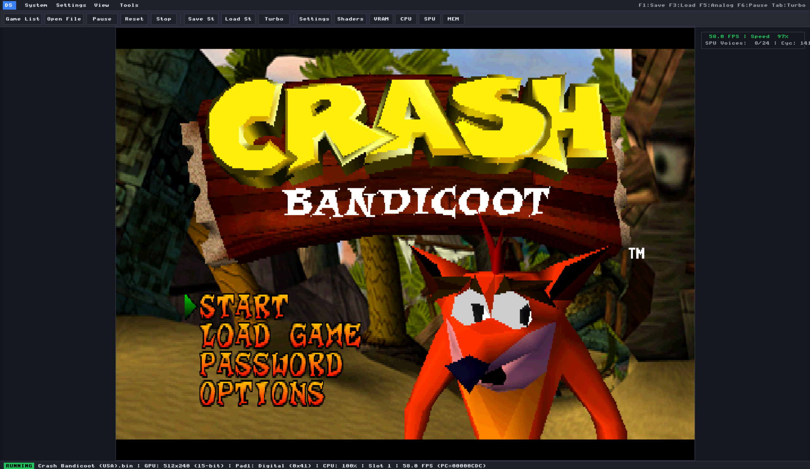

# PlayStation 1 Emulator in Rust

A work-in-progress PlayStation 1 emulator with a desktop interface and a headless diagnostic mode. It implements CPU execution, software graphics rendering, disc access, video decoding, audio synthesis, and controller protocols in Rust.

Compatibility and hardware timing are incomplete. The project is not cycle accurate.

## Gameplay capture



*Gran Turismo 2 (USA), Arcade Mode: maintainer-supplied gameplay capture, added 2026-11-15. The interface and diagnostic overlay are visible. The displayed FPS/speed values are emulator-reported readings from this moment, not an independent performance benchmark.*

[Download the accompanying gameplay recording (MP4, approximately 48 MB)](docs/media/gran-turismo-2-gameplay.mp4).



*Crash Bandicoot (USA): maintainer-supplied title-screen capture, added 2026-11-15. This screenshot demonstrates reaching the menu, not gameplay completion.*

[Download the accompanying Crash Bandicoot recording (MP4, approximately 46 MB)](docs/media/crash-bandicoot-recording.mp4).

These captures document local sessions. Source revisions, host hardware, BIOS revisions, and full settings were not recorded with the files, so they do not establish reproducibility against the current checkout.

Earlier full-VRAM diagnostic captures remain available: [BIOS boot](bios_boot_v2.png) and [Ridge Racer loading](ridge_boot.png). Those images include textures and off-screen buffers; they are not active-display gameplay screenshots.

## Implemented components

- CPU interpreter with load and branch delay handling, exceptions, COP0, and GTE operations.
- Memory map, scratchpad, interrupts, timers, and DMA, including GPU linked lists and MDEC transfers.
- Software GPU rasterization for polygons, textures/CLUTs, rectangles, lines, blending, and VRAM transfers.
- CD-ROM command/sector handling and MDEC macroblock decoding for video playback.
- SPU voice synthesis, ADPCM, ADSR, interpolation, reverb, and CD-XA/CD-DA decoding and mixing. Host audio output uses Windows WaveOut.
- Digital and analog controller protocols; Windows XInput and WinMM host input.
- Desktop game loading, pause/frame step, five in-memory save-state slots, display filters, and CPU/GTE, VRAM, audio, and memory inspection tools.
- Headless runs with instruction limits, instruction tracing, CPU-state JSON, and VRAM PPM export.

The sole direct Cargo dependency is `minifb`; see [Cargo.toml](Cargo.toml).

## Build and run

Windows is the primary development platform. Install Rust/Cargo and the native linker/build tools for your chosen Rust toolchain. For the usual MSVC toolchain, install Visual Studio Build Tools with the C++ desktop workload and Windows SDK. Other platforms have fallback code paths, but native file dialogs, audio output, and host-gamepad support are Windows-specific; other platforms have not been verified here.

```powershell
git clone https://github.com/noahyoung47/ps1-emulator-rust.git
cd ps1-emulator-rust
cargo build --release --locked
cargo run --release --locked -- --window
```

The last command opens the interface; it does not boot a commercial game without local files. Select a BIOS and open a disc in the interface, or supply both on the command line:

```powershell
cargo run --release --locked -- --bios "C:\path\to\SCPH1001.BIN" --cd-bin "C:\path\to\game.bin" --window
```

Supply your own legally obtained BIOS and game images. None are included. The disc loader reads a single file into memory and detects raw 2352-byte sectors or otherwise treats data as 2048-byte sectors. It does not parse CUE track layouts or compressed CHD/PBP containers. Multi-track fidelity is not established.

PS-X executables can be loaded with `--exe "C:\path\to\test.exe"`. With a BIOS, loading is queued through a BIOS shell hook; without one, the executable is sideloaded directly.

### Basic controls

| Action | Keyboard |
| --- | --- |
| D-pad | Arrow keys or W/A/S/D |
| Start / Select | Enter / Right Shift or Backspace |
| Cross / Circle / Square / Triangle | Z / X / C / V |
| L1 / R1 / L2 / R2 | Q / E / 1 / 2 |
| Save / load current state slot | F1 / F3 |
| Cycle state slot | F2 |
| Toggle digital/analog pad | F5 |
| Pause / advance one frame / reset | F6 / F7 / F8 |
| Export full VRAM to `vram_screenshot.ppm` | F10 |

Save states are stored in memory and disappear when the application closes. Memory-card probes emulate an absent card; persistent in-game saves are not implemented.

## Compatibility observations

The observations below document specific milestones, not full-game playability or complete hardware fidelity. The Gran Turismo 2 row and the Crash title-screen observation describe maintainer-supplied media added during this review. The other game results below are **historical reports** from [the 2026-10-25 investigation](diagnostics/README.md). The cited logs and later gameplay captures are local artifacts absent from this repository. The historical runs have not been reproduced during this documentation review; BIOS/disc files were unavailable. Game revisions, image hashes, and capture settings were not fully recorded.

| Title | Reported observation | Scope and remaining uncertainty |
| --- | --- | --- |
| Gran Turismo 2 (USA), Arcade Mode | Maintainer supplied a racing screenshot and accompanying gameplay recording; the screenshot shows the desktop interface and an active race. | Capture revision and host details unrecorded; full-game compatibility, sustained performance, and audio accuracy unverified. |
| Crash Bandicoot (USA) | New supplied screenshot shows the title screen; an accompanying recording is included. Historical investigation: reached N. Sanity Beach and rendered gameplay after a CD-sector scheduling fix; 1.5 billion instructions without the previously observed address error. | New screenshot verifies the menu only; the supplied recording has not been independently reviewed. Historical result is a bounded headless run; full playthrough and sustained performance unverified. |
| Final Fantasy VII (USA), Disc 1 | New Game decoded 601 consecutive movie frames, roughly 40 seconds, without the reported MDEC output timeout after partial DMA-register writes were fixed. | Opening movie regression only; later gameplay and complete audio/video synchronization unverified. |
| Ridge Racer | Reached the race in a 1.3-billion-instruction run without unexpected CPU exceptions; scripted input opened the pause menu. | Bounded headless progression; full race completion and GUI performance unverified. |
| Castlevania (exact release unspecified) | Repository contains a VRAM capture under this name. | No documented gameplay result; compatibility unknown. |

## Debugging and tests

```powershell
cargo test --release --locked
```

On Windows with Rust 1.99.1, the 2026-11-15 documentation review ran **41 passing tests, 0 failures, and 1 ignored local-disc probe**. Tests cover CPU delay/exception behavior and selected GTE operations, memory mapping, graphics commands, DMA, CD sectors, MDEC, controller transactions, audio synthesis/mixing, and UI state/rendering. They do not establish general hardware conformance. The historical external CPU test result in the investigation notes has no established reference result and is not counted as a conformance pass.

For a bounded run using local files:

```powershell
cargo run --release --locked -- --bios "C:\path\to\SCPH1001.BIN" --cd-bin "C:\path\to\game.bin" --headless --max-cycles 1000000 --dump-state-json "state.json" --dump-vram "vram.ppm"
```

Despite its name, `--max-cycles` limits the interpreter's instruction-step counter, not accurately modeled hardware clock cycles. The headless default is 1,000,000 steps; window mode runs until closed unless a limit is supplied. JSON exports CPU/TTY state, not a resumable save state. PPM exports full VRAM. Add `--trace` to write instruction addresses, words, and registers to stderr. `--pad-buttons` takes an active-low hexadecimal pad mask (`FFFF` releases all buttons). Unknown options are silently ignored; there is no implemented `--help` screen.

The ignored `game_probe` test requires a BIOS named exactly `SCPH1001.BIN` in the repository root and a local image selected with `GAME_BIN`:

```powershell
$env:GAME_BIN = 'C:\path\to\game.bin'
$env:GAME_CYCLES = '600000000'
$env:GAME_OUT = 'diagnostics/probe'
cargo test --release --locked game_probe -- --ignored --nocapture
```

The probe sends scripted Start/confirm input and exports CPU state, RAM, full VRAM, and active-display PPM captures. Its movie counter uses an FFVII-specific program address; it is not a general video-frame counter. See [diagnostics/README.md](diagnostics/README.md) for game-specific settings and optional instruction history.

### Technical investigations

- **Disc scheduling and asset loading:** the investigation traced Crash's address error to an unresolved asset lookup. Sector delivery changed from a fixed 2,048-step interval to scheduling based on 75/150 sectors per second. Tests check cadence and location metadata, though the CPU time model remains simplified.
- **Video and DMA coordination:** interleaved XA audio must bypass the CPU movie-data path when decoding is enabled. MDEC output DMA waits for decoded data, and byte/halfword writes to DICR preserve unaffected control and acknowledgement bits. The investigation identifies partial DICR writes as the final fix for FFVII's first-frame stall.
- **Decoder correctness:** targeted tests exercise inverse zigzag ordering, unquantized blocks, IDCT output, and DMA waiting/resumption. These isolate specific behavior from a long game boot.

## AI-assisted development

The original command-line emulator core was created by multiple background Gemini agents, using a shared Google Drive workspace to coordinate research and source code. The source was then moved into the Antigravity IDE for compilation, testing, and further feature development.

The maintainer guided the project through successive iterations: directing the shared workspace setup, identifying features and changes to improve usability and emulator capabilities, guiding testing in Antigravity, and validating updates throughout development. Hands-on testing included describing visual and audio problems that were difficult to diagnose from code or logs alone, providing feedback to guide further changes.

This workflow combined agent-generated research and implementation code with maintainer direction, hands-on testing, and iterative validation. The repository's regression tests and local-disc diagnostic harness provide checks for specific behaviors; the results and their limits are documented above.

## Known limitations

- CPU/peripheral timing is simplified; BIOS/game VSync timeout messages have been reported.
- CD command scheduling and partial/in-flight MDEC input remain areas for investigation.
- Audio decoding and mixing exist in the current source, but accuracy, synchronization, and host playback across games are not established by unit tests.
- Memory cards and disk-persistent save states are absent. Do not rely on this emulator for preserving game progress.
- Disc layout support, platform coverage, and real-time performance need broader validation.
- Future gameplay and diagnostic captures should include the commit, BIOS/disc revision, host hardware, and settings.

## Source guide

| File | Role |
| --- | --- |
| [src/cpu.rs](src/cpu.rs) | CPU execution, exceptions, and GTE |
| [src/bus.rs](src/bus.rs) | Memory map, software GPU, DMA, CD-ROM, MDEC, and device integration |
| [src/spu.rs](src/spu.rs) | Audio synthesis, decoding, and host output |
| [src/gamepad.rs](src/gamepad.rs) | Controller state and host input |
| [src/ui.rs](src/ui.rs) | Desktop interface and inspection tools |
| [src/main.rs](src/main.rs) | CLI parsing, loading, input, and execution loops |
| [src/game_probe.rs](src/game_probe.rs) | Ignored integration diagnostic using local files |

For useful bug reports, include the commit, OS/toolchain, command or UI settings, BIOS/disc identifiers (without uploading the files), reproduction steps, and observed output. Keep generated dumps and copyrighted binaries out of contributions.

## License

This repository currently has no license file. No open-source license grant is specified for the project code.
